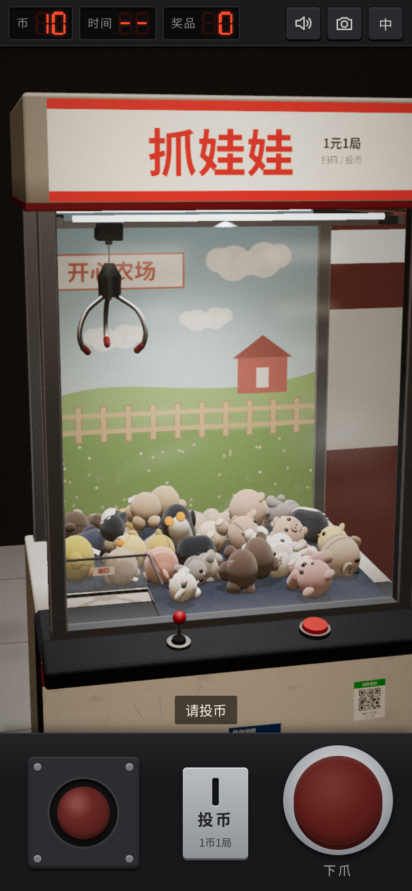

# 爪爪乐 · PAW PLAY

A mobile-first 3D claw machine in the browser, styled after current Chinese mall Gen-2 cabinets (white glossy body, bright accent, LED rims, circular PRIZE OUT). **Play: https://hejuntt1014.github.io/claw-machine/**



- **Look:** procedural Gen-2 cabinet — white clearcoat body, pink/yellow/cyan accent themes (chip on the HUD), aluminium frame, breathing LED edge strips, backlit “爪爪乐 / PAW PLAY” lightbox, cute geometric backboard with an original blob mascot (not a licensed IP), circular illuminated 取物口, caster wheels. Neighbouring machines share the same language. Soft glass UI cards replace the old retro LED board.
- **Physics:** Rapier3D (WASM). Pendulum claw, motorized prongs, random grip, chute → pickup window, take-out animation.
- **Desktop & mobile:** portrait deck / landscape side columns, keyboard + mouse + touch + gamepad, theme chips, fullscreen, safe-area insets.

## Dev
```
npm install
npm run dev
npm run build      # base /claw-machine/; VITE_BASE=./ for other hosts
npm test
```
