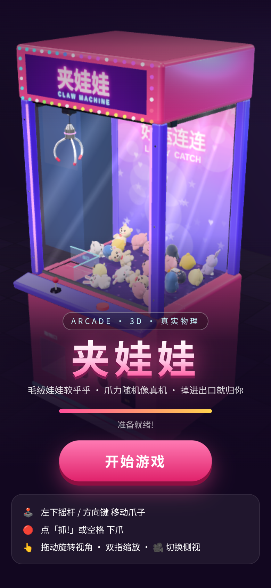

# 3D 夹娃娃机 · Claw Machine

A mobile-first 3D claw machine that runs in the browser. **Play: https://hejuntt1014.github.io/claw-machine/**



- **Rendering:** Three.js with PBR materials, RoomEnvironment lighting, PCF shadows, Neutral tone mapping and UnrealBloom. There are three quality levels (低/中/高), and quality drops automatically when the frame rate is low.
- **Physics:** Rapier3D (WASM). The claw is a kinematic hub that swings on its cable like a pendulum, with three prongs on motorized revolute joints. Grip strength is random each round and weakens after lifting, like a real machine.
- **Plush toys:** built entirely in code, with no model files. They use a custom plush shader with sheen fabric, fibre normal maps, stitched seams, fur shells, and vertex deformation for a soft feel: squash and wobble on impact, dents where the prongs grip, and sagging where a toy rests on the floor.
- **Arcade feel:** synthesized WebAudio sound effects and music, vibration on supported phones, a win overlay with confetti, flashing marquee lights and the prize door.

## Dev
```
npm install
npm run dev        # dev server
npm run build      # static build -> dist/ (base /claw-machine/; VITE_BASE=./ for other hosts)
npm test           # headless physics simulation of grab rounds
```

Controls: joystick or arrow keys/WASD move the claw, 「抓!」 or Space drops it, drag to orbit the camera, pinch to zoom, and 🎥 cycles the camera views.
